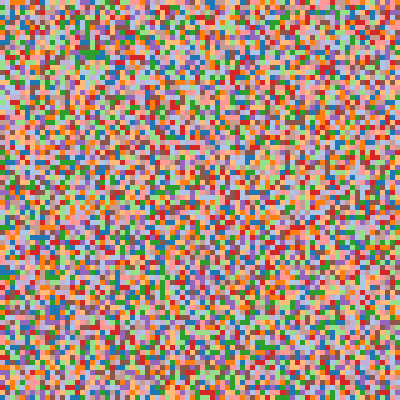
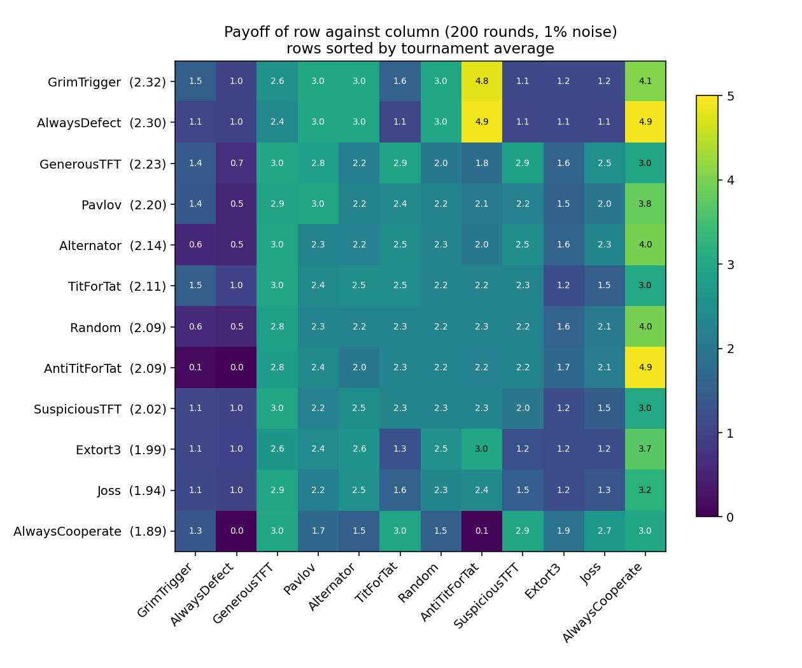
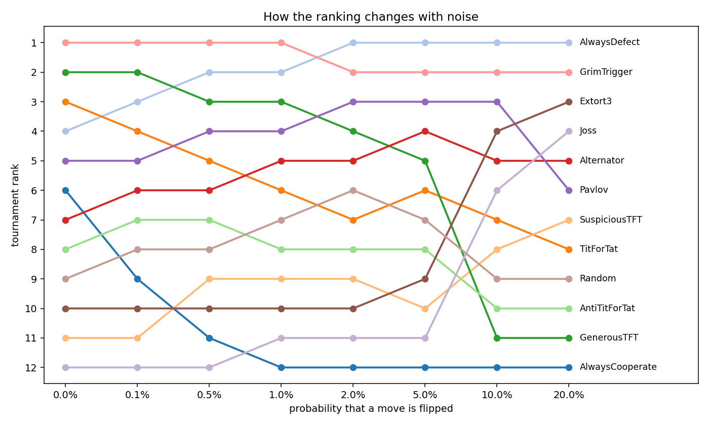
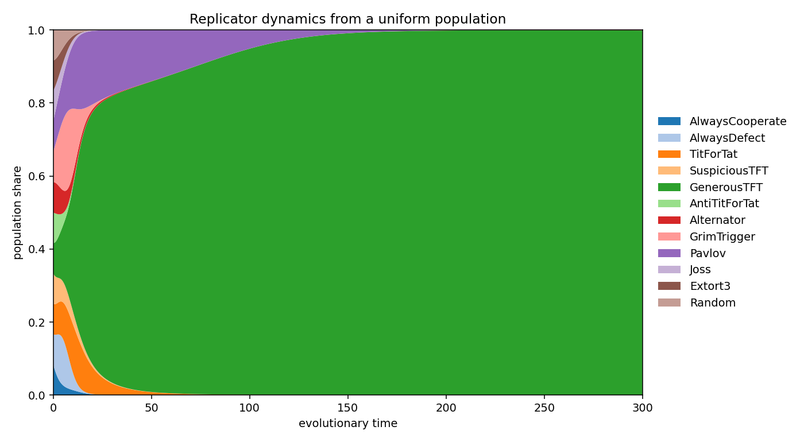
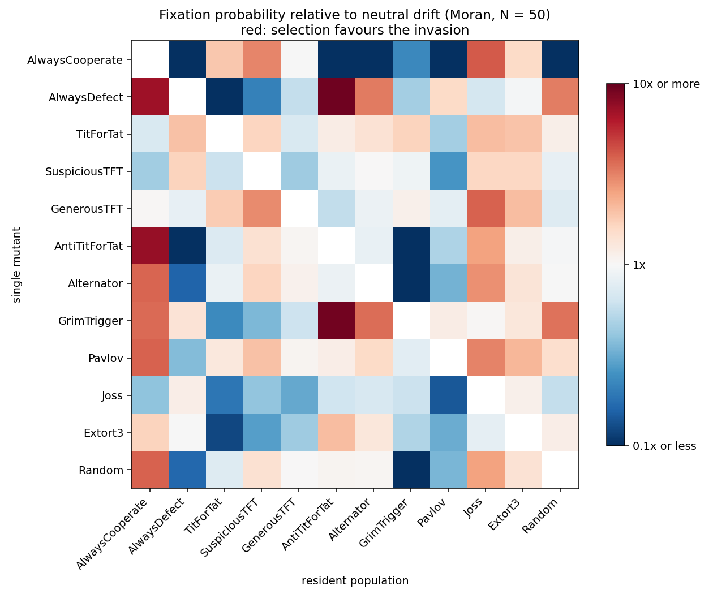
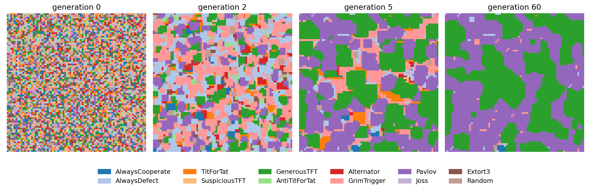

# Iterated prisoner's dilemma arena

Tit for Tat is famous for winning tournaments. This project asks what happens to that reputation when players make mistakes, when strategies reproduce according to how well they do, when they only meet their neighbours, and when agents have to learn how to play from scratch.



*Every pixel is a player. It plays its eight neighbours, then copies whoever scored best around it. Purple blocks are Pavlov, green ones Generous Tit for Tat.*

## The setup

Twelve classic strategies, all of them memory-one: they only look at the previous round. That makes each match a four-state Markov chain, so **expected payoffs are computed exactly**, noise included, with no Monte Carlo error. A move-by-move simulator is used in the tests to cross-check the maths.

Payoffs are T=5, R=3, P=1, S=0, matches last 200 rounds and, unless stated otherwise, each move is flipped with probability 1%.

## Results

### 1. The round robin

| Rank | Strategy | Average payoff |
|---|---|---|
| 1 | Grim Trigger | 2.32 |
| 2 | Always Defect | 2.30 |
| 3 | Generous Tit for Tat | 2.23 |
| 4 | Pavlov | 2.20 |
| 5 | Alternator | 2.14 |
| 6 | Tit for Tat | 2.11 |



Unforgiving strategies do well here because the field contains exploitable players. The ranking depends on who shows up as much as on the strategy itself.

### 2. Noise reshuffles everything



Without mistakes Tit for Tat ranks third. A single flipped move can lock two Tit for Tat players into retaliation, and its rank slides as noise grows. Over a very long match with any noise, two Tit for Tat players average 2.25, the mean of all four payoffs, instead of 3.

### 3. Survival is not the same as winning the tournament

Under replicator dynamics, starting from equal shares, Generous Tit for Tat ends with 99.8% of the population, even though it finished third in the round robin. Always Defect disappears once it runs out of victims.



The starting mix matters. Across 2,000 random initial populations, the largest share at the end belongs to Generous Tit for Tat in 66% of cases, Grim Trigger in 29% and Pavlov in 5%.

### 4. Can a single mutant take over?

In a finite population of 50 (Moran process), each cell shows how much more likely a single newcomer is to take over than under pure chance.



Tit for Tat is a good first invader of Always Defect: about twice as likely to fix as a neutral mutant, while Always Defect invading Tit for Tat has less than a tenth of the neutral chance.

### 5. Neighbours change the outcome

On an 80 x 80 grid, defectors and Grim Trigger expand first, then Pavlov and Generous Tit for Tat build clusters and take over. After 60 generations they hold 51% and 47% of the cells (one random start).



### 6. Learning agents rediscover Pavlov

Two independent Q-learners, which see only the previous round, play each other for 300,000 rounds while exploring less and less. Over 20 random seeds:

- 19 runs end with an average payoff above 2.5, close to full cooperation.
- In 17 of them **both agents learn Pavlov** (win-stay, lose-shift), 12 of those opening with a defection.
- Against a fixed Tit for Tat the learner always cooperates (20 of 20); against Always Defect it settles on defecting.

### 7. The best memory-one strategy against this field

A grid search over the four response probabilities finds: open with cooperation, then cooperate with probability **1 after CC, 0.5 after CD, 0 after DC and 0.2 after DD**. It averages 2.55 against the twelve strategies, above the tournament winner. It was optimised on this exact field (and does not play against itself), so it describes the field more than it describes a generally strong player.

## Run it

```bash
pip install -r requirements.txt
python -m pytest
python run_experiments.py      # about 7 minutes; writes results/ and figures/
```

Adding a strategy takes one line in [ipd/strategies.py](ipd/strategies.py):

```python
FORGIVING = Strategy("Forgiving", first=1, p=(1, 0.5, 1, 0.5))  # CC, CD, DC, DD
```

Add it to `FIELD` and every analysis includes it.

## Layout

```
ipd/strategies.py   the field
ipd/game.py         exact Markov-chain payoffs and a simulator
ipd/population.py   replicator, Moran fixation, spatial game
ipd/learning.py     independent Q-learning
run_experiments.py  every table and figure
tests/              exact vs simulated, known theoretical results
```

## Checks against theory

The test suite verifies that noisy Tit for Tat tends to (T+R+P+S)/4, that Press and Dyson's extortionate strategy enforces its linear relation between payoffs against any opponent, that neutral fixation probability is 1/N, and that the exact payoffs agree with simulation.

## Background

This grew out of the repeated-games exercises of the Game Theory course at the University of Buenos Aires, where Tit for Tat, its opposite and a fixed alternating sequence are compared by hand. Those three pairings are reproduced in the tests.

## References

- Axelrod, R. (1984). *The Evolution of Cooperation*. Basic Books.
- Nowak, M. and Sigmund, K. (1993). A strategy of win-stay, lose-shift that outperforms tit-for-tat in the Prisoner's Dilemma game. *Nature*, 364.
- Nowak, M. and May, R. (1992). Evolutionary games and spatial chaos. *Nature*, 359.
- Press, W. and Dyson, F. (2012). Iterated Prisoner's Dilemma contains strategies that dominate any evolutionary opponent. *PNAS*, 109(26).
